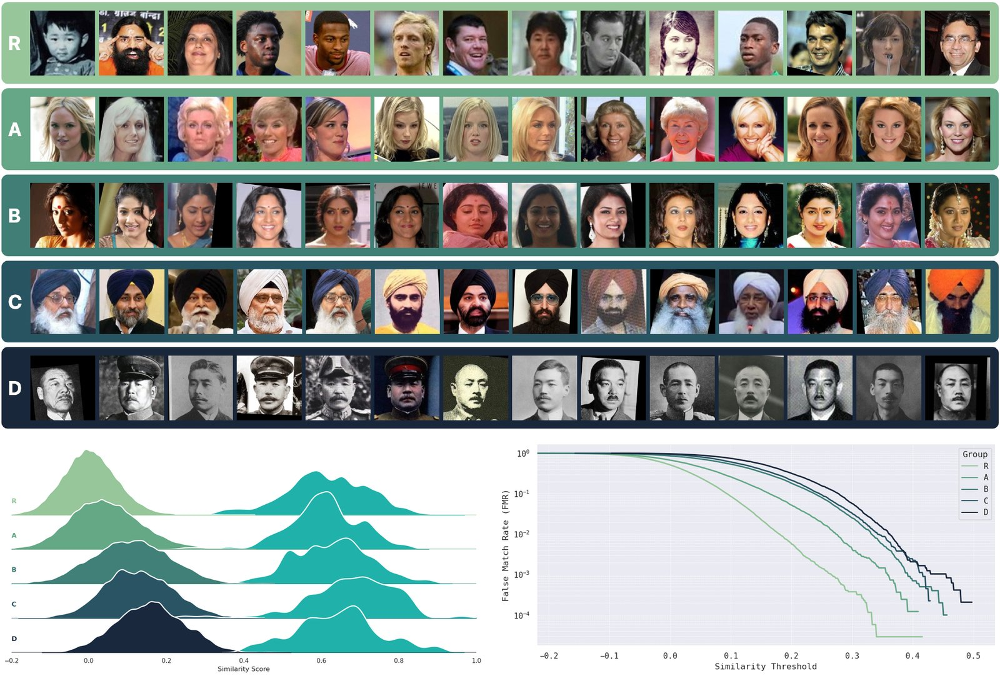
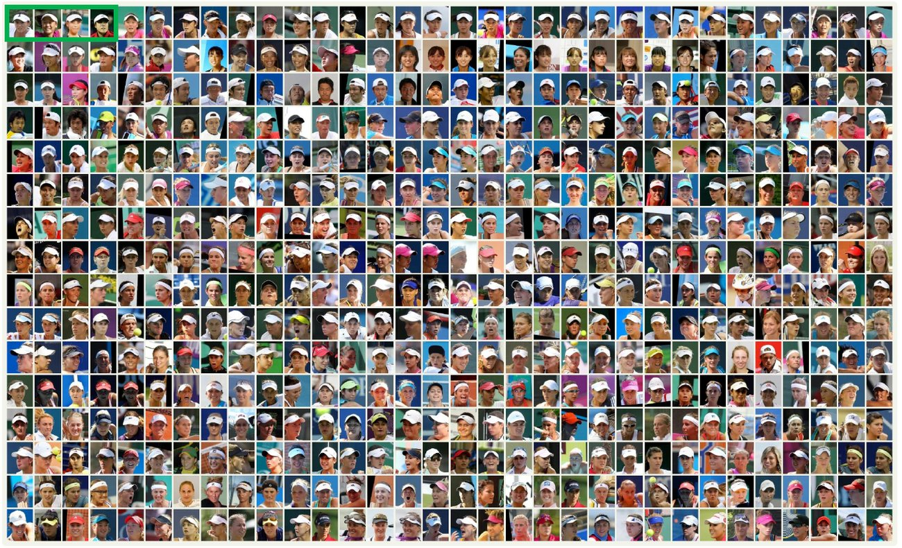
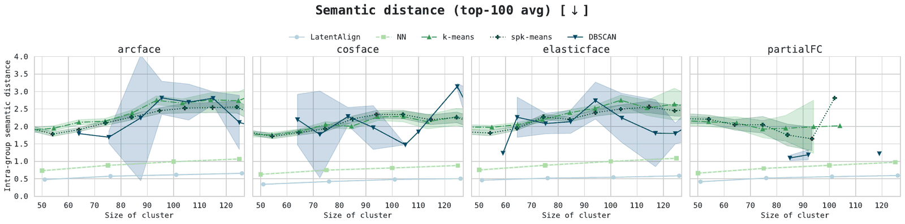
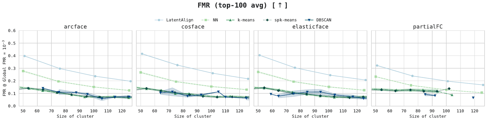
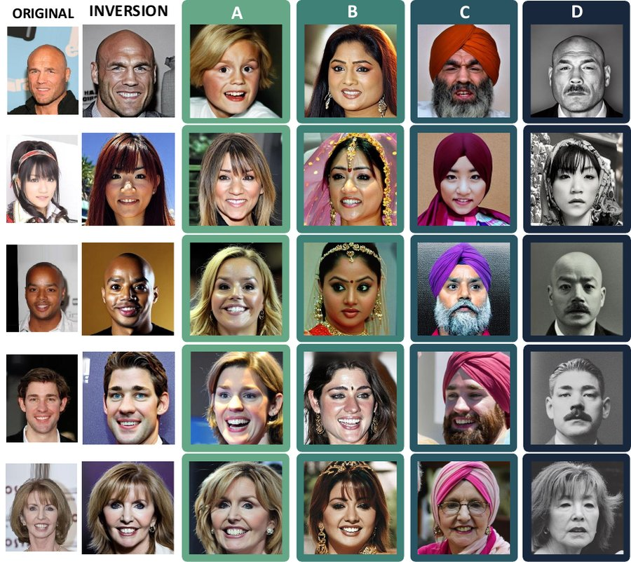

<div align="center">

# LatentAlign

### Discovering Intersectional Bias via Directional Alignment in Face Recognition Embeddings

**Ignacio Serna** · Center for Humans & Machines, Max Planck Institute for Human Development

*WACV 2027*

[](https://arxiv.org/abs/2510.15520)
[](https://wacv.thecvf.com/)
[](LICENSE)
[](pyproject.toml)

</div>

<p align="center">
  
</p>

<p align="center"><sub><b>Intersectional groups discovered by LatentAlign on ArcFace (RFW).</b> R: random sample; A: blonde white women; B: young Indian women; C: Indian men with turbans; D: Chinese men with mustaches in black-and-white photographs. Bottom: within-group impostor (left) and genuine (right) similarity distributions, and the False Match Rate as a function of the threshold. The darker the group, the more its impostor scores shift towards the genuine ones.</sub></p>

## Summary

Face recognition audits usually compare predefined demographic groups. The groups a model actually fails on are often much narrower: a combination of age, ancestry, attire or capture conditions that no label taxonomy anticipates. **LatentAlign** finds them without attribute labels. It grows a group from a seed by repeatedly adding the face embedding most aligned with the group's identity-balanced direction, and stops when no remaining face is aligned enough. The groups it returns are more semantically coherent than those of standard clustering, and they expose **false match rates up to 6× higher** than the annotation-defined groups a supervised audit can build.

## Why directions?

Modern face recognition models are trained with angular-margin losses that place embeddings on the unit hypersphere and pull images of the same person into tight clusters. The space fragments into thousands of identity clusters, and proximity-based clustering mostly recovers identities. Attributes shared *across* identities (age, hair, headwear, a black-and-white photograph) behave instead as directions on the sphere. LatentAlign follows them:

```
S ← seed images
repeat
    v ← normalize( Σ_{j∈S} e_j / count(identity_j) )     # identity-balanced direction (Eq. 1)
    i ← argmax_{k∉S} ⟨e_k, v⟩                            # most aligned face (Eq. 2)
    if ⟨e_i, v⟩ < τ: stop
    S ← S ∪ {i}
```

Because the embeddings are unit-norm, the most aligned face is also the nearest neighbor of the group's spherical centroid: LatentAlign is a greedy, seed-anchored centroid expansion. What matters is how it differs from clustering:
- **It never partitions the space.** It grows one group from a seed and stops, so most faces are never assigned.
- **Identities are balanced.** No single identity dominates the direction.
- **Every added face stays in the group.** The accumulated group anchors the direction. Re-selecting the whole group from the current direction drifts towards dense regions unrelated to the seed.

<p align="center">
  
</p>
<p align="center"><sub>Grown from four seed images of different identities (green box) on CelebA, LatentAlign keeps retrieving new people who share the attribute, not the seeds' identities. Images in the order they were added.</sub></p>

## Results

**More coherent groups.** Average intra-group attribute distance (lower is better) for groups of ~100 images grown from the same k-means++ seeds:

| | RFW ArcFace | RFW CosFace | RFW ElasticFace | RFW PartialFC | CelebA ArcFace | CelebA CosFace | CelebA ElasticFace | CelebA PartialFC |
|---|---|---|---|---|---|---|---|---|
| Nearest neighbors | 2.78 | 2.58 | 2.73 | 2.63 | 8.47 | 8.42 | 8.43 | 8.45 |
| k-means | 3.01 | 2.81 | 2.96 | 3.01 | 7.73 | 7.61 | 7.73 | 7.66 |
| Spherical k-means | 2.65 | 2.38 | 2.63 | — | 8.06 | 7.97 | 8.07 | 8.04 |
| DBSCAN | 2.13 | 2.29 | 2.46 | — | 6.94 | 7.50 | 7.17 | 7.47 |
| Weighted-SVD | 2.07 | 2.18 | 1.99 | 2.16 | 7.23 | 7.17 | 7.18 | 7.03 |
| **LatentAlign** | **1.89** | **1.63** | **1.89** | **1.73** | **6.61** | **6.55** | **6.57** | **6.74** |

<p align="center">
  
  
</p>
<p align="center"><sub>Parameter sweeps on RFW: semantic distance of the 100 most coherent groups (top, lower is better) and FMR of the 100 most biased groups (bottom, higher reveals more bias), by group size, at the threshold where the whole dataset has FMR = 10⁻³.</sub></p>

**Bias hidden by broad labels.** FMR at the global threshold where FMR = 10⁻³, for the discovered groups A–D and for the groups that annotations with the same attributes define (ArcFace):

| | A | B | C | D |
|---|---|---|---|---|
| Annotation-defined | 0.003 | 0.019 | 0.062 | 0.052 |
| **LatentAlign** | **0.018** (6.4×) | **0.077** (4.1×) | **0.090** (1.5×) | **0.153** (2.9×) |

Across the four backbones the gap ranges from 1.3× to 6.4×.

**Slice discovery.** In an adaptation of [Domino](https://github.com/HazyResearch/domino) to pairwise verification (`domino/`), 97% of the 2,800 100-image LatentAlign groups exceed Domino's best slice, and the median group has 6× the FMR of the median slice.

**The directions are interpretable.** Moving a face embedding along a group's direction and decoding it with an identity-conditioned generator (here Arc2Face) adds the group's attributes to a new face. The directions were discovered on RFW and applied to CelebA faces.

<p align="center">
  
</p>

## Quick start

```python
import numpy as np
from latentalign import grow_threshold, kmeanspp_seeds

E = ...    # (N, 512) L2-normalised face embeddings
ids = ...  # (N,) identity labels (only used to balance identities)

seeds = kmeanspp_seeds(E, k=400)                                   # one single-image seed per k-means++ centroid
groups = [grow_threshold([s], E, ids, tau=0.34) for s in seeds]   # grow each seed along its direction
```

`grow_threshold_batched` grows many groups in lock-step and is much faster on large datasets.

## Repository structure

```
latentalign/                  Python package
  algorithm.py                LatentAlign (Eq. 1-2, Algorithm 1)
  seeding.py                  k-means++, similarity-graph and random seeds
  baselines.py                NN search, k-means, spherical k-means, DBSCAN, weighted-SVD
  metrics.py                  semantic distance, global threshold, group FMR, EER/FNMR, bootstrap
  data.py                     RFW / CelebA loaders
  summary.py                  top-100 worst-case summaries (Figs. 4-5)
  results_db.py               SQLite storage of discovered groups
  traversal.py                slerp
preprocessing/
  embeddings/                 face embedding extraction (4 backbones + antelopev2 for Arc2Face)
  annotation/                 VLM annotation of RFW (5 notebooks), vote merging, statistics, human validation
experiments/                  one script per table / figure (see below)
traversals/                   Arc2Face and InfiniteYou traversals, attribute classifier, Fig. 3
domino/                       Domino adapted to verification: Tab. 3, Supp. G (+ other slice-discovery baselines)
data/                         annotations, group indices, seeds shipped with the repo (see data/README.md)
docs/REPRODUCIBILITY.md       table/figure -> script mapping, parameters and known caveats
tests/                        equivalence tests and synthetic smoke test
assets/                       figures of this README
```

## Installation

```bash
git clone https://github.com/ignacioserna/LatentAlign.git && cd LatentAlign
pip install -r requirements.txt   # core experiments (CPU is enough; spherical k-means uses PyTorch)
pip install -e .
```

Embedding extraction, the VLM annotation and the generative traversals have
their own heavier requirements (InsightFace, the VLMs, Arc2Face, InfiniteYou);
they are listed at the top of the corresponding scripts/notebooks.

## Data

The experiments use [RFW](http://www.whdeng.cn/RFW/) and
[CelebA](https://mmlab.ie.cuhk.edu.hk/projects/CelebA.html). Neither dataset is
redistributed here (the figures of this README are those of the paper); request/download them from their authors and follow
`data/README.md`. The RFW attribute annotations produced with the five VLMs,
the index lists of the groups A-D and the CelebA seeds are included in `data/`.

## Reproducing the paper

```bash
export LATENTALIGN_DATA=/path/to/data        # contains RFW/ and CelebA/

# 0. embeddings (GPU)
python preprocessing/embeddings/extract_embeddings.py --dataset rfw    --models-dir /path/to/MODELS
python preprocessing/embeddings/extract_embeddings.py --dataset celeba --models-dir /path/to/MODELS
python preprocessing/embeddings/extract_arc2face_embeddings.py --dataset rfw
python preprocessing/embeddings/extract_arc2face_embeddings.py --dataset celeba

# 1. RFW annotations (the merged labels are already in data/annotations/rfw)
python preprocessing/annotation/majority_vote.py --rule strict && python preprocessing/annotation/resolve_multiface.py --rule strict
python preprocessing/annotation/majority_vote.py --rule plurality && python preprocessing/annotation/resolve_multiface.py --rule plurality
python preprocessing/annotation/annotation_stats.py        # Supp. Tab. 2
python preprocessing/annotation/human_validation.py        # Supp. Tab. 3, Supp. Fig. 1 (1K human annotations shipped)

# 2. parameter sweeps on RFW (writes results/db/*.db)
python -m experiments.run_sweeps --methods latentalign weighted_svd nn kmeans kmeans_all skmeans dbscan graph_init random_init

# 3. tables and figures
python -m experiments.global_thresholds                    # operating points (global FMR = 1e-3)
python -m experiments.table1 --dataset rfw                 # Tab. 1 (RFW)
python -m experiments.table1 --dataset celeba              # Tab. 1 (CelebA)
python -m experiments.fig4_fig5                            # Figs. 4-5
python -m experiments.table2_groups                        # Fig. 1(b,c), Tab. 2, Supp. Tabs. 4-5, Supp. Figs. 2-3
python -m experiments.table3_latentalign_fmr               # Tab. 3 (LatentAlign row), Sec. 4.5
python -m experiments.identity_overlap                     # Sec. 4.4, selection effects
python -m experiments.supp_fig4_fig5_sensitivity --init graph    # Supp. Fig. 4
python -m experiments.supp_fig4_fig5_sensitivity --init random   # Supp. Fig. 5
python -m experiments.supp_table6_celeba_kmeans            # Supp. Tab. 6
python -m experiments.supp_figs6_12_celeba_groups --all    # Supp. Figs. 6-12

# 4. Domino comparison: Tab. 3, Supp. Tabs. 7-9, Supp. Fig. 13 (see domino/README.md)
#    cd domino && bash scripts/run_both_thresholds.sh WORK LATENTALIGN_DB NAMES

# 5. traversals (GPU, see traversals/*)
python traversals/arc2face/traverse_arc2face.py --mode removal    # Fig. 2(a)
python traversals/arc2face/traverse_arc2face.py --mode addition   # Fig. 2(b)
python traversals/attribute_classifier/predict_attributes.py --images ... --out ...  # Fig. 3 classifier (weights: v1.0.0 release)
python traversals/fig3_aggregate.py && python traversals/plot_fig3.py   # Fig. 3
```

All outputs are written to `results/`. `docs/REPRODUCIBILITY.md` lists, for
every table and figure, the script, the parameters, the expected runtime and
the known caveats.

## Citation

```bibtex
@inproceedings{serna2027latentalign,
  title     = {Discovering Intersectional Bias via Directional Alignment in Face Recognition Embeddings},
  author    = {Serna, Ignacio},
  booktitle = {Proceedings of the IEEE/CVF Winter Conference on Applications of Computer Vision (WACV)},
  year      = {2027}
}
```

## Responsible use

LatentAlign is an auditing tool. The subpopulations it surfaces are those an
adversary would target, so we publish the method and group-level rates, not
per-identity scores. The discovered directions describe a model's geometry,
not the people in the images, and must not be read as evidence that any
demographic group is intrinsically harder to recognise. RFW is derived from
MS-Celeb-1M, which has been withdrawn by its creators; we only use the RFW
verification protocol as distributed by its authors and train no model on it.

## License

Code released under the MIT License (see `LICENSE`). `preprocessing/embeddings/arcface_torch`
is taken from [InsightFace](https://github.com/deepinsight/insightface) (MIT) and
`traversals/infiniteyou` reuses code from [InfiniteYou](https://github.com/bytedance/InfiniteYou) (Apache-2.0).
The RFW annotations in `data/annotations` are released for research use only, subject to the RFW terms. The attribute-classifier weights (v1.0.0 release) were trained on MAAD-Face annotations and are released for research use only, subject to the MAAD-Face terms.
